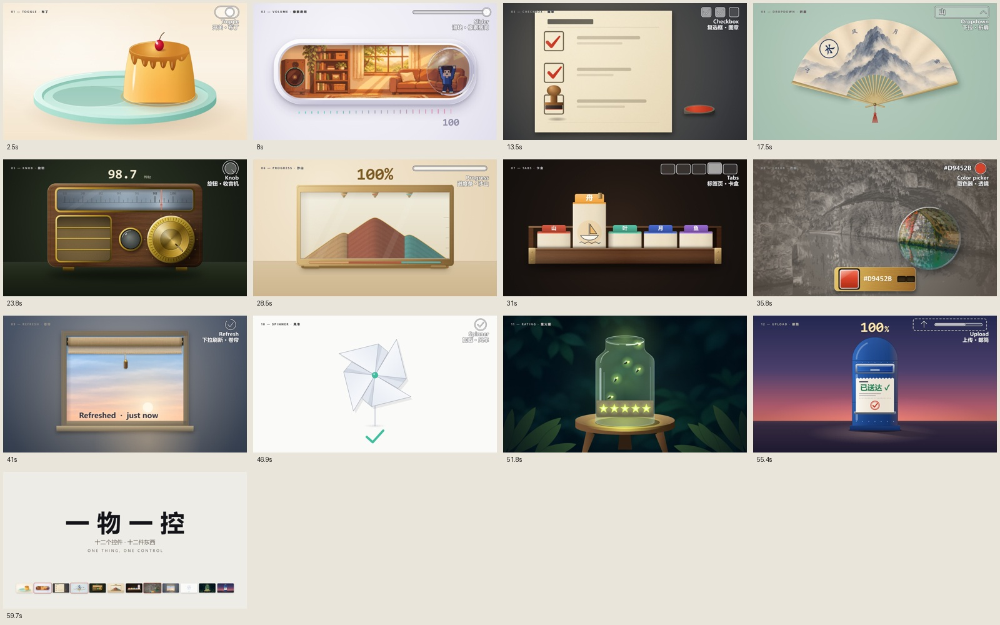

# 第 02 期 · 用 AI，把日常做成 UI

《一物一控》：12 种日常物件，对应 12 类界面控件。这里提供本期 60 秒视频 v3 的浏览器动效源码、成片所用图片、合成音轨、时间线和复刻提示词。

本期为 **Canvas 动效演示工程**：动作按时间线播放，可查看指定帧和指定控件值；物件本身尚未接入实时鼠标拖拽、业务上传或表单状态。需要可直接操作的五场景原型，可先体验仓库根目录的第一期 `index.html`。



## 运行

下载仓库 ZIP 并解压，或 `git clone https://github.com/shenqili/AI4UI.git`。在仓库根目录运行：

```sh
python -m http.server 8000
```

用 Chrome / Edge 打开：

```text
http://localhost:8000/episodes/02-everyday-ui/film/film.html
```

点击 **PLAY WITH SOUND** 开始。空格暂停/继续，左右方向键跳转两秒，Home 回到开头。运行浏览器演示无需 npm 安装、外部接口或 API Key，音轨和图片已在本地。

## 12 个场景

| 时间 | 控件 | 日常物件 | 源码 |
| --- | --- | --- | --- |
| 1–4 秒 | Toggle 开关 | 布丁 | [s01_pudding.js](film/scenes/s01_pudding.js) |
| 4–11 秒 | Slider 音量滑块 | 像素房间 | [s02_pixelroom.js](film/scenes/s02_pixelroom.js) |
| 11–15 秒 | Checkbox 复选框 | 图章 | [s03_stamp.js](film/scenes/s03_stamp.js) |
| 15–20 秒 | Dropdown 下拉菜单 | 折扇 | [s04_fan.js](film/scenes/s04_fan.js) |
| 20–25 秒 | Rotary 旋钮 | 收音机 | [s05_knob.js](film/scenes/s05_knob.js) |
| 25–29 秒 | Progress 进度 | 沙山 | [s06_sand.js](film/scenes/s06_sand.js) |
| 29–32 秒 | Tabs 标签切换 | 索引卡盒 | [s07_cards.js](film/scenes/s07_cards.js) |
| 32–37 秒 | Color picker 取色 | 透镜 | [s08_lens.js](film/scenes/s08_lens.js) |
| 37–42 秒 | Pull to refresh 下拉刷新 | 卷帘 | [s09_blind.js](film/scenes/s09_blind.js) |
| 42–48 秒 | Loading 加载 | 风车 | [s10_pinwheel.js](film/scenes/s10_pinwheel.js) |
| 48–52 秒 | Rating 评分 | 萤火罐 | [s11_firefly.js](film/scenes/s11_firefly.js) |
| 52–56 秒 | Upload 上传 | 邮筒 | [s12_postbox.js](film/scenes/s12_postbox.js) |

0–1 秒为片头，56–60 秒为终章总览。右上角的标准控件与物件状态同步，便于理解两者关系。

## 查看某一帧或某个控件

在演示地址后追加参数：

```text
?t=13.5&hud=2                 图章场景指定帧
?t=59.7&hud=2                 终章总览
?solo=s02&p=0.5&drag=0.5      像素房间，控件值 50%
?solo=s12&p=1                邮筒完成态
```

`solo` 是静态检查模式，值来自 URL；`t` 是全片秒数。`hud=0` 隐藏片头角标等 HUD，`hud=2` 保留精简标签。这些参数不代表实时拖拽交互。

## 从提示词开始复刻

1. 阅读 [PROMPTS.md](PROMPTS.md)，一次选择一个物件控件。
2. 先检查数值 0、0.5、1 的画面，再安排动作过程。
3. 场景的 `mount` 创建画布，`render(c)` 按进度、时间与事件绘制。
4. 用 [ASSET_PROMPTS.md](ASSET_PROMPTS.md) 了解纹理与插画素材的生成方向。

提示词为根据实际制作整理的可复用版本，并非完整私有会话逐字导出。

## 工程结构

```text
film/film.html          浏览器播放入口
film/engine.js          场景引擎、参数模式、控件叠加层
film/cues.js            已生成时间线
film/scenes/            片头和 12 个物件场景
film/assets/            演示实际使用的图片
film/audio/mix.mp3      程序合成音乐与拟音
audio/                 合成器、时间线和音频分析脚本
tools/build_assets.js  把重新生成的音轨、事件写入 film/
PROMPTS.md             场景复刻与评审提示词
ASSET_PROMPTS.md       原始素材生成提示词
```

## 可选：重新生成音轨或导出视频

重新合成音轨需要 Node.js 和 PATH 中的 ffmpeg。在本期目录执行：

```sh
node audio/gen_cues.js
node audio/gen_audio.js
node tools/build_assets.js
```

音轨由本地合成器生成，未包含上一期使用的商业歌曲。详细节奏设计见 [audio/README.md](audio/README.md)。

`film/render_video.js` 和 `film/shot.js` 保留原制作脚本；它们按 Windows Chrome 默认路径编写，导出前需核对本机 Chrome 路径、可用端口、Node.js 的全局 WebSocket 支持与 ffmpeg。浏览器查看无需这些导出工具。视频文件、浏览器配置、渲染缓存及发布后台截图未收录。

## 作品

[抖音 · 用 AI，把日常做成 UI](https://www.douyin.com/video/7706775951752908059)

代码与部分视觉素材由 AI 辅助制作，用于学习交互表达、动效编排与视觉实现；场景中的上传、音量等读数属于演示状态。
